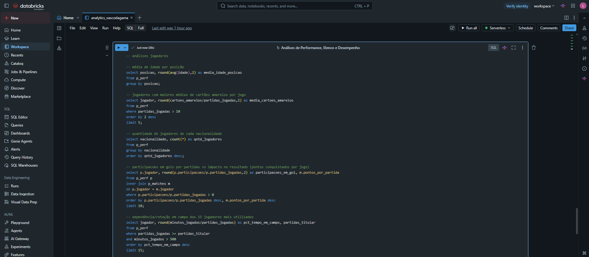
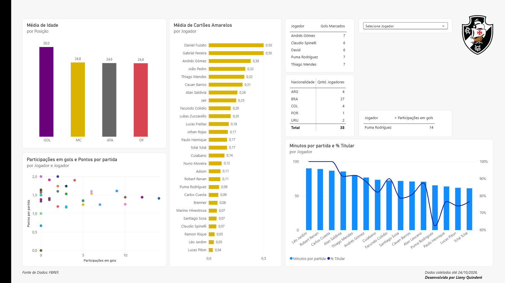
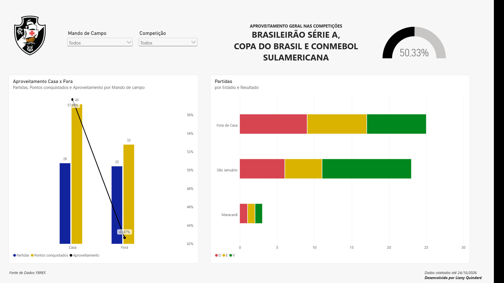

## Vasco da Gama - Data Analytics & Performance Dashboard

Projeto completo de Data Analytics focado na análise de desempenho do elenco e rendimento tático do Vasco da Gama nas competições da temporada (Brasileirão Série A, Copa do Brasil e CONMEBOL Sul-Americana).
O projeto engloba desde a extração, tratamento e transformação dos dados via Databricks/SQL, até a modelagem avançada (DAX) e construção de dashboards interativos no Power BI.

## Arquitetura e Fluxo do Pipeline

- Ingestão e Tratamento (Databricks / Spark SQL / DAX):
- Limpeza de dados brutos e padronização de posições de atletas (ex: tratamento de exceções como Colidio e Rojas).
- Consolidação das métricas de desempenho de elenco (p_perf) e de partidas (partidas).
- Validação de regras de negócio via queries SQL (mando de campo, estádio e estatísticas individuais).
- Modelagem e Métricas (Power Query & Power BI DAX):
- Regra condicional para pontuação (SWITCH para Vitórias = 3, Empates = 1, Derrotas = 0).
- Criação de medidas calculadas para Pontos por Partida, % de Titularidade, Participações Diretas (G+A) e Aproveitamento Geral/Mando.

## Visualização de Dados (Power BI Dashboard):
- Relatório interativo dividido em visão de Performance do Elenco e Resultados/Mando de Campo.

## Processamento de Dados no Databricks

As consultas e transformações SQL foram desenvolvidas no Databricks para garantir dados consistentes.

## Visualização do Dashboard (Power BI)

1. Performance do Elenco 

- Média de Idade por Posição: Análise da maturidade tática do grupo (Goleiros, Meias, Atacantes e Defensores).
- Média de Cartões Amarelos: Atletas com maior taxa de indisciplina/minutagem.
- Minutos por Partida x % Titularidade: Análise da rotação dos 15 jogadores mais utilizados (>500 minutos jogados).
- Gráfico de Dispersão (Decisividade): Cruzamento da média de Pontos por Partida conquistados com a presença do atleta em campo versus suas Participações em Gol (Gols + Assistências).

2. Análise de Resultados e Mando de Campo 
- Aproveitamento Geral: Gauge/KPI de eficiência global do time nas competições (50.33%).
- Desempenho Casa vs. Fora: Comparativo de pontos conquistados, partidas disputadas e variação da taxa de aproveitamento (57,69% em casa vs. 42,67% fora).
- Estatística por Estádio: Detalhamento do volume de Vitórias, Empates e Derrotas comparando a força de São Januário contra as partidas no Maracanã.

## Principais Fórmulas DAX Utilizadas

-- Calculo da Coluna de Pontos por Partida;
-- Taxa de Aproveitamento (%);

## Principais Funções/Comandos Utilizados em SQL
-- SELECT
-- WHERE
-- JOIN
-- CASE WHEN
-- FILTER
-- GROUP BY
-- ORDER BY

Desenvolvido por: Liany Quinderé
Fonte dos Dados: [FBref ](https://fbref.com/en/squads/83f55dbe/Vasco-da-Gama-Stats) (Dados coletados até 24/10/2026)
